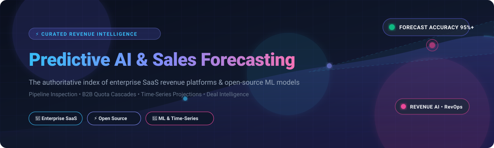

  

# 🚀 Awesome Predictive AI & Sales Forecasting 📈

> **The definitive curated list of top Predictive AI and Sales Forecasting platforms** — featuring enterprise SaaS revenue intelligence suites, B2B pipeline prediction tools, and production-grade open-source machine learning models for forecasting sales pipeline, quota cascading, predicting deal outcomes, and time-series modeling.

  
  
  
  
  
  

  🌟 <b>Star this repository if you find it helpful for your sales operations, machine learning workflows, or RevOps stack!</b> 🌟

---

## 📋 Table of Contents

- [🌐 Sector Overview & Market Dynamics](#-sector-overview--market-dynamics)
- [🏢 SaaS & Hosted Commercial Platforms](#-saas--hosted-commercial-platforms)
- [💻 Open-Source Software & Algorithms](#-open-source-software--algorithms)
- [📊 Key Selection Criteria & Feature Comparison](#-key-selection-criteria--feature-comparison)
- [🤝 Contributing](#-contributing)
- [💖 Support & Community](#-support--community)
- [📈 Star History](#-star-history)
- [📄 License](#-license)

---

## 🌐 Sector Overview & Market Dynamics

The global **Sales Forecasting Software and Revenue Intelligence** market is currently estimated at **$3.6B – $3.8B** and is projected to surge beyond **$10.7B – $12.4B+** by the early 2030s, compounding at an annual growth rate (CAGR) of **11.0% – 12.4%**. 

### 🔍 Market Fragmentation & Structural Landscape
* **Moderately Fragmented & Dual-Tiered:** Rather than a strict "winner-take-all" monopoly, the market is characterized by a two-tier equilibrium:
  1. **Core CRM Hyperscalers:** Monolithic systems like *Salesforce* capture the default recording layer and baseline workflow analytics across millions of enterprise seats.
  2. **Specialized High-Fidelity Intelligence Engines:** Platforms like *Clari*, *Gong*, and *Aviso* thrive by solving the acute limitations of standard CRMs—specifically offering multi-modal conversation intelligence, automated pipeline triangulation, and 95%+ precision machine forecasting.
* **Open-Source Emergence:** While commercial tools excel at enterprise workflows, the open-source landscape provides specialized time-series forecasting algorithms (ARIMA, LightGBM, XGBoost, Prophet, LSTMs) and RevOps data pipelines (quota cascading, pipeline waterfall diffing) that give engineering teams complete sovereignty over proprietary sales telemetry.

---

## 🏢 SaaS & Hosted Commercial Platforms

Below is a detailed breakdown of industry-leading commercial cloud platforms for AI sales forecasting and revenue orchestration, sorted in **descending order by company scale** (Market Cap / Valuation / ARR).

| 🏢 Platform | 💰 Company Size (Valuation / ARR) | 🏷️ Starting Tier Pricing | 🎁 Free Tier / Trial Limits | 🎯 Primary AI & Forecasting Capabilities |
|---|---|---|---|---|
| **[Salesforce Einstein Forecasting](https://www.salesforce.com/products/sales-cloud/)** | **~$280B+ Market Cap** (~$38B ARR) | **$25/user/month** (Starter Suite); Native Einstein Forecasting available in Enterprise ($175/user/month) & Unlimited ($350/user/month) or add-on packages | **30-day full-featured free trial** (No credit card required; access to sales pipelines, reports, customizable dashboards, and guided CRM setup) | Native CRM predictive forecasting, opportunity win scoring, deal trend insights, and collaborative forecasting rollups. |
| **[Gong](https://www.gong.io/)** | **$7.25B Valuation** (~$250M–$300M+ ARR) | **~$108–$133/user/month** billed annually (~$1,300–$1,600/user/year) base seat + $5,000–$50,000 annual platform fee | **No public self-serve free tier**; 14-day to 30-day invite-only sales pilot available for qualified enterprise pipeline evaluations | Multi-modal conversation intelligence (calls/emails/meetings) triangulated with CRM health and AI deal-outcome forecasting. |
| **[Clari](https://www.clari.com/)** | **$2.6B Valuation** (~$150M–$180M+ ARR) | **~$90–$120/user/month** billed annually (Accelerator Tier) + standard enterprise implementation & onboarding | **No self-serve free tier**; custom guided proof-of-concept (PoC) sandbox trial available via sales scoping for qualified enterprise teams | Enterprise revenue cadence orchestration, slip-deal detection, board-level forecast projections, and 95%+ precision modeling. |
| **[Revenue.io](https://www.revenue.io/)** | **~$500M Valuation** (~$35M–$60M ARR) | **$95–$175/user/month** billed annually (Activate/Engage tier starting rates; minimum 15 seats typical) | **No self-serve free tier**; customized demo sandbox and guided evaluation upon request with enterprise sales engineers | Real-time conversation coaching (*Moments*), dialer telemetry, deal-risk signals, and Salesforce-native predictive forecasting. |
| **[BoostUp.ai](https://www.boostup.ai/)** | **~$100M–$250M Valuation** (~$15M–$30M ARR) | **~$79/user/month** billed annually (Standard platform entry bracket, sales-led enterprise deployment) | **No self-serve free tier**; customized proof-of-concept (PoC) sandbox demo provided for prospective mid-market/enterprise buyers | Product-led growth (PLG) and consumption/usage-based revenue forecasting with direct data warehouse synchronization. |
| **[Aviso](https://www.aviso.com/)** | **~$60M Venture Backed** (~$15M–$25M ARR) | **~$40–$100+/user/month** billed annually (typically subject to a $50,000+ annual platform minimum) | **No self-serve free tier**; structured enterprise pilot/proof-of-concept (PoC) testing available through sales and engineering | AI agentic RevOps, multi-metric sales forecasting, sandbagging detection, and predictive deal win-rate analytics. |

---

## 💻 Open-Source Software & Algorithms

Self-hosted, community-driven Predictive AI models, sales forecasting engines, and RevOps developer frameworks, sorted by **GitHub Stargazers Count** (descending).

### 🥇 [LenzDu/Kaggle-Competition-Favorita](https://github.com/LenzDu/Kaggle-Competition-Favorita) 
* **Stack:** Python 🐍 / LightGBM ⚡ / GBDT
* **License:** Open Source
* **Summary:** The 5th place competitive machine learning solution for large-scale grocery retail sales forecasting. Features state-of-the-art lag feature engineering, categorical embeddings, promo effect modeling, and gradient boosting ensembles.
* **Best For:** Data science teams seeking battle-tested feature engineering pipelines and high-dimensional tabular sales prediction models.

### 🥈 [davidthaler/Walmart_competition_code](https://github.com/davidthaler/Walmart_competition_code) 
* **Stack:** R 📊 / Statistical Modeling / Time-Series Decomposition
* **License:** Open Source
* **Summary:** The 1st place winning code repository for the Walmart Store Sales Forecasting competition on Kaggle. Demonstrates championship-grade time-series decomposition, holiday adjustments, and markdown impact modeling.
* **Best For:** Quantitative researchers and analysts needing robust statistical baselines for multi-store seasonal demand forecasting.

### 🥉 [mollyryanruby/sales_forecasting](https://github.com/mollyryanruby/sales_forecasting) 
* **Stack:** Python 🐍 / scikit-learn / XGBoost / Prophet / ARIMA
* **License:** MIT
* **Summary:** A comprehensive comparative benchmark implementing five distinct machine learning and statistical techniques to forecast product sales, with automated evaluation metrics (MAE, RMSE, MAPE).
* **Best For:** Developers and data analysts seeking an accessible reference framework to compare classical time-series against tree-based regression.

### 🔹 [Akajiaku11/Sales-Forecasting](https://github.com/Akajiaku11/Sales-Forecasting) 
* **Stack:** Python 🐍 / ARIMA / statsmodels / pandas
* **License:** Open Source
* **Summary:** An end-to-end time-series analysis and sales prediction pipeline leveraging ARIMA and seasonal SARIMA models to forecast future demand from historical enterprise transaction datasets.
* **Best For:** RevOps analysts seeking clean, reproducible statistical ARIMA pipelines for predictable baseline forecasting.

### 🔹 [samirsaci/ml-forecast-features-eng](https://github.com/samirsaci/ml-forecast-features-eng) 
* **Stack:** Python 🐍 / pandas / scikit-learn
* **License:** MIT
* **Summary:** Production-ready feature engineering library tailored specifically for machine learning sales and demand forecasting, covering promotional indicators, rolling statistics, calendar seasonality, and price elasticity signals.
* **Best For:** ML engineers building custom sales forecasting systems who need modular, leak-free feature extraction scripts.

### 🔹 [aasimansari1/Sales-Forecasting-System](https://github.com/aasimansari1/Sales-Forecasting-System) 
* **Stack:** Python 🐍 / Streamlit 🎈 / XGBoost / Prophet / LSTM / ARIMA
* **License:** MIT
* **Summary:** An AI-powered full-stack sales forecasting and inventory planning application integrating 5 ML models (XGBoost, ARIMA, Prophet, LSTM), an interactive analytics dashboard, anomaly detection, and RFM customer segmentation.
* **Best For:** Organizations seeking a turnkey, interactive web UI combining predictive time series with inventory alerts and customer segmentation.

### 🔹 [MMBazel/Classifying-Sales-Calls](https://github.com/MMBazel/Classifying-Sales-Calls) 
* **Stack:** Python 🐍 / XGBoost / AWS Redshift / SQLAlchemy / pandas
* **License:** MIT
* **Summary:** An end-to-end revenue intelligence pipeline translating Salesforce lead logs, opportunity updates, and rep activity signals into predictive deal outcome classifications and win-probability scores.
* **Best For:** RevOps teams looking to connect data warehouse CRM activity streams directly to predictive deal-closing models.

### 🔹 [anshkumar2311/AI-Powered-Sales-Forecasting-Dashboard](https://github.com/anshkumar2311/AI-Powered-Sales-Forecasting-Dashboard) 
* **Stack:** Python 🐍 / Streamlit 🎈 / Plotly / Prophet
* **License:** MIT
* **Summary:** An interactive AI-driven sales forecasting dashboard built with Streamlit and Plotly, enabling sales managers to visualize KPIs, experiment with trend seasonality parameters, and export forecast data.
* **Best For:** Small business operators and internal sales leads needing a lightweight, visual forecasting tool without complex setup.

### 🔹 [goran-revops/pipeline-diff](https://github.com/goran-revops/pipeline-diff) 
* **Stack:** Python 🐍 / HubSpot & Salesforce Connectors
* **License:** MIT
* **Summary:** An open-source pipeline change tracker and waterfall dashboard for HubSpot and Salesforce. Accurately tracks deal snapshot movements between forecast categories, surfaces deal slippage, and formats logs for AI agent ingestion.
* **Best For:** RevOps analysts seeking local-first, privacy-conscious visibility into why quarterly pipeline forecasts moved.

### 🔹 [cfagan17/overnight-gtm](https://github.com/cfagan17/overnight-gtm) 
* **Stack:** Python 🐍 / PostgreSQL 🐘 / Supabase
* **License:** MIT
* **Summary:** An AI operating layer for go-to-market and RevOps that coordinates autonomous agent loops (deal inspection, pipeline review, territory planning) backed by PostgreSQL Row-Level Security (RLS) governance.
* **Best For:** Technical GTM engineers deploying auditable AI agents with explicit safety rails over corporate CRM and pipeline records.

---

## 📊 Key Selection Criteria & Feature Comparison

| Solution Category | Primary Strengths | Data Requirements | Deployment Complexity | Target Audience |
|---|---|---|---|---|
| **Enterprise SaaS Suites** *(Clari, Gong, Aviso)* | Automated CRM ingestion, conversation AI, board-ready cadences | Deep historical CRM records & active email/calendar sync | Low dev effort (vendor implementation 4–8 weeks) | Large enterprise sales orgs ($20M+ ARR) |
| **Native CRM Add-ons** *(Salesforce Einstein)* | Zero third-party integration, unified permissions & roles | Strict minimums (12+ months history, >80% amount filled) | Instant turn-on if prerequisites are satisfied | Existing Salesforce Cloud enterprise customers |
| **Open-Source ML Frameworks** *(XGBoost, Prophet, ARIMA)* | Total algorithmic control, zero per-seat licensing costs | Structured tabular sales history or data warehouse extract | High dev & MLOps effort (custom feature pipeline required) | Data science & internal analytics engineering teams |
| **Open-Source RevOps Utilities** *(pipeline-diff, overnight-gtm)* | Local-first data sovereignty, pipeline change explainability | Direct API access to HubSpot / Salesforce or Postgres | Moderate (Python CLI / self-hosted database script) | RevOps analysts & modern GTM engineers |

---

## 🤝 Contributing

Contributions are warmly welcomed! If you know of an awesome open-source Predictive AI or Sales Forecasting tool, model, or dataset that belongs on this list:

1. 🍴 **Fork** the repository.
2. 🌿 Create a new feature branch (`git checkout -b feature/add-new-forecasting-tool`).
3. 📝 Add your project with:
   - Project name and GitHub repository URL
   - Concise description (1–2 sentences highlighting unique capabilities)
   - Tech stack and open-source license
   - Why it stands out for sales forecasting, time-series prediction, or RevOps
4. 🚀 Submit a **Pull Request** with a descriptive title.

Please ensure all suggested projects are actively maintained and genuinely open-source.

---

## 💖 Support & Community

Thank you for exploring this curated repository! If you find this collection valuable for your sales analytics, engineering work, or research:

- ⭐ **Star this repository** to show your appreciation and help other developers discover it!
- 🍴 **Fork it** to build custom internal benchmarks or curate your team's tools.
- 📢 **Share it** on LinkedIn, X/Twitter, or Reddit with your RevOps and Data Science peers.
- ☕ **Buy me a coffee & support ongoing maintenance:** Visit the [GitHub Sponsors Dashboard](https://github.com/sponsors/ishandutta2007) to help support the continued curation of awesome open-source tools!
- 💬 **Join the conversation:** Connect with fellow builders on [Discord](https://discord.gg/jc4xtF58Ve)!

---

## 📈 Star History

---

## 📄 License

This compilation is released under the [Creative Commons Zero v1.0 Universal](https://creativecommons.org/publicdomain/zero/1.0/) (CC0 1.0 - Public Domain Dedication). All linked software tools, libraries, and trademarks remain the property of their respective creators.

---

  <b>⭐ If this guide helped you uncover the right predictive AI sales tool, remember to star the repo! ⭐</b>

